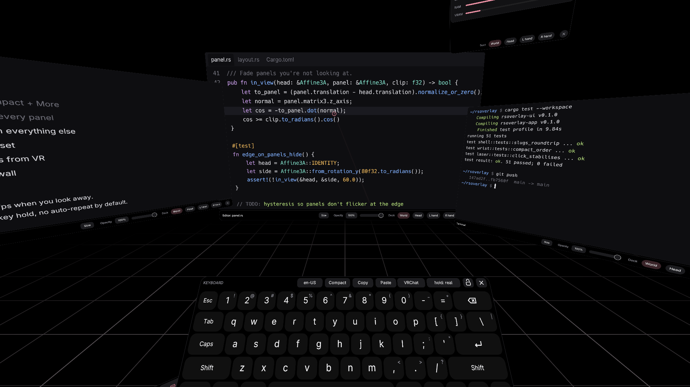
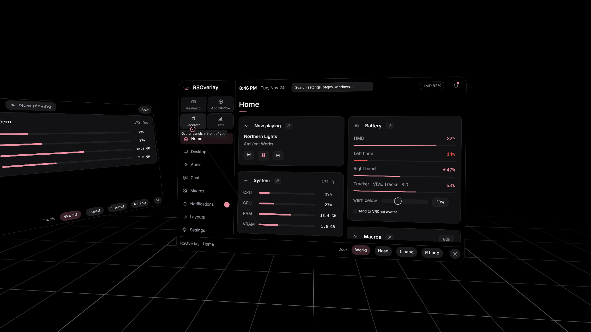
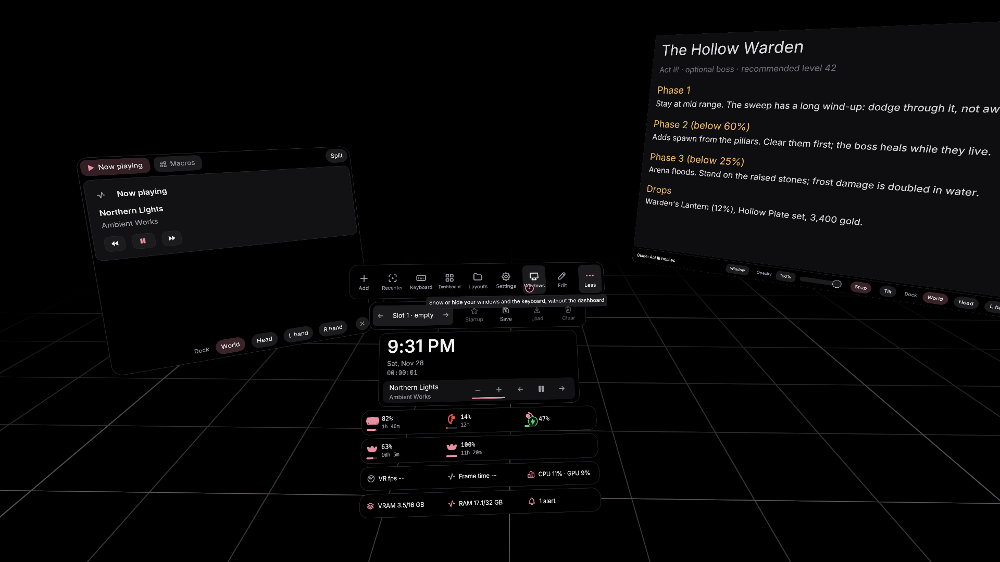
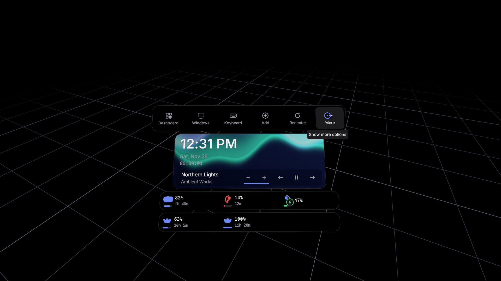

# RSOverlay

An open-source SteamVR overlay written in Rust, for gamers and for people
who work in VR. Bring your desktop windows into VR, keep a smartwatch-style
toolbar on your wrist, type on a real keyboard layout, and see why your game
is lagging, all from one native app that's built to stay out of your
frame budget.



| | |
|---|---|
|  |  |
|  |  |

<sub>Everything at a glance: [overview.png](docs/store/overview.png) ·
every setting: [settings-overview.png](docs/store/settings-overview.png).
Screenshots are rendered by the built-in VR preview (`--vr-preview --scene …`)
with mock window contents. See [docs/store](docs/store/README.md).</sub>

> **Status:** early testing. Grab the latest test build from
> [Releases](https://github.com/affectioned/RSOverlay/releases); a Steam
> release is planned.

## Download

1. Download `RSOverlay-<version>-windows-x64.zip` from
   [Releases](https://github.com/affectioned/RSOverlay/releases) and unzip it
   anywhere.
2. Double-click `rsoverlay.exe`. With SteamVR and your headset available it
   starts in VR; otherwise it opens the desktop settings window. From then
   on SteamVR starts RSOverlay by itself (toggle it in SteamVR › Settings ›
   Startup / Shutdown). (`v0.1.0-beta.1` still needs `rsoverlay.exe --vr`.)
3. RSOverlay tells you when a new version is out (Settings › Updates) and
   shows what's new. Nothing updates by itself: click **Install update** and
   it downloads, checks and swaps in the new version, then restart when it
   suits you (or grab the zip yourself). Testers can turn on **Include test
   builds**.

## Why

The popular overlays are built on Unity, Mono and Chromium, and pay for it
in RAM and CPU. RSOverlay is one native Rust binary: `wgpu` on DX12, GPU-to-GPU
capture (no frame ever goes through the CPU), and `egui` for the UI. Panels
you aren't looking at drop to ~5 fps, and hidden ones cost nothing.
Settings › **RSOverlay performance** measures its own CPU, RAM, VRAM and
frame time live, so you can check the claim yourself.

## Features

**Windows and desktops**
- Mirror any monitor (DXGI duplication, cursor included) or any single
  window (Windows Graphics Capture), several at once
- Laser mouse on the real window: left, right and middle click, drag,
  stick scroll
- Per-window opacity, so you can keep an eye on your game world through a
  window
- UAC aware: elevated windows show a clear "use your PC" notice, with an
  optional run-as-administrator mode

**Panels in space**
- Grab to carry, stick to push/pull and resize (one at a time, or both),
  two-hand scale, optional tilt with your controller, with a live
  size/distance readout while you do it
- Every panel (windows, widgets, the dashboard) docks to world, head, left
  or right hand, and has a close button
- Snap windows edge to edge into a wall that moves together
- Closing the dashboard hides every window you haven't pinned; pinned ones
  stay up. Everything steps aside while the SteamVR menu is open
- Recenter gathers everything in front of you; panels fade when viewed
  edge-on
- 8 layout slots, with one auto-loaded at startup, and your last session
  restored
- Resolution setting for sharp text on high-resolution headsets

**Wrist toolbar**
- A smartwatch on your wrist: pick what it shows (clock, media, batteries,
  layouts, status chips for VR fps, CPU/GPU, VRAM, RAM and alerts) and
  arrange it in VR
- Every button is labelled; tooltips name the rest

**PC performance**
- CPU, busiest core, GPU, RAM and VRAM, plus SteamVR frame timing in VR:
  game fps vs your headset's refresh rate, GPU headroom and reprojection,
  red when the game is falling behind

**Dashboard**
- Labelled sidebar; global search across settings, pages and windows
  (everyday actions live on the wrist, not duplicated here)
- Pop any card out as a floating widget; drop widgets onto each other to
  merge them into tabs, split them back out

**Keyboard**
- Physical layout with labels from your system keyboard layout
- Real key hold (no fake auto-repeat, which matters in games), sticky and
  lockable modifiers, VRChat chatbox mode, compact or full

**Everything else**
- Notifications: WebSocket API on `127.0.0.1:42069`, toasts + history.
  It accepts the same JSON as XSOverlay's notification API, so apps that
  already send notifications (VRCX etc.) work unchanged
  ([NOTIFICATION_API.md](docs/NOTIFICATION_API.md))
- Media: now playing + controls (SMTC); optional accent from album art
- Per-app volume mixer (WASAPI)
- Batteries for HMD, controllers and trackers, with playtime estimates,
  low-battery alerts and an optional VRChat avatar parameter (OSC)
- VRChat OSC chatbox, including "share now playing"
- Macros, night light (the interface is English for now; translations are planned)
- Discord Rich Presence ("In VR · 3 windows open", headset battery,
  optionally your music), switched on / off live in Settings › Discord
- Custom sounds for typing and every alert: drop in your own WAVs
  ([how-to](docs/SOUNDS.md))
- Accessibility: VR text size, pointer size, reduce motion, laser
  visibility, cursor smoothing, scroll speed

**SteamVR integration**
- SteamVR Input with default bindings for Index, Touch, Vive and WMR,
  all rebindable in SteamVR
- Registers itself as a SteamVR overlay app: starts with SteamVR (toggle in
  SteamVR › Startup) and exits with it

## Default controls

| Action | Input |
|---|---|
| Click / drag | Trigger |
| Right / middle click | Hold trackpad down / up while clicking (Index, Vive, WMR), or bind dedicated buttons in SteamVR |
| Grab a panel | Grip |
| Push / pull, resize (while grabbing) | Stick up/down, left/right |
| Show / hide dashboard | Double-press left A / X (or the wrist Dashboard button) |

Change any of these in SteamVR › Settings › Controllers › Manage Controller
Bindings › RSOverlay.

## Run

```bash
cargo run -p rsoverlay-app                   # VR if SteamVR + headset are available, else desktop
cargo run -p rsoverlay-app -- --vr           # VR only
cargo run -p rsoverlay-app -- --desktop      # desktop window + dev harness
cargo run -p rsoverlay-app -- --vr-preview   # the headset view, on your desktop
```

The desktop window has a **DEV bar** across the top: switch live between the
desktop dashboard, VR dashboard, wrist, VR keyboard (the mouse acts as the
laser), widgets, window panel and toasts, each at its real VR size, and fire
demo batteries, a low-battery alert or test notifications (default / warning
/ error / silent). It's hidden in `--screenshot` runs (`RSO_DEV_BAR=1` keeps it).

`--vr-preview` renders every panel in 3D through the same UI code as VR, so
design work doesn't need a headset. Keys **1–6** switch layout presets (work,
gaming, social, dashboard, wrist compact, wrist expanded); drag to look,
scroll to move, R resets the view.

After the first VR run, SteamVR launches RSOverlay automatically.

### Common flags

```
--vr / --desktop / --vr-preview   mode (default: VR when available, else desktop)
--list-monitors / --list-windows  print capture sources and exit
--monitor <idx>                   monitor to mirror in the preview (default 0)
--window <title>                  mirror a window instead of a monitor
--no-mirror / --no-gpu-mirror     disable capture / force the CPU path
--notify-bind <addr>              notification server (default 127.0.0.1:42069)
--no-notify / --no-osc
--discord-app-id <id>             use a different Discord application
--osc-addr <addr>                 VRChat OSC input (default 127.0.0.1:9000)
--scene <preset>                  --vr-preview layout preset
--screenshot <png> --exit-after <frames>   headless render-to-PNG
```

### Test the notification server

```powershell
.\tools\send-toast.ps1 -Title "Build green" -Content "cargo clippy clean"
```

## Build

```bash
cargo build --workspace
cargo test --workspace
cargo clippy --workspace --all-targets
cargo deny check
```

Windows x64, Rust stable (edition 2021). Settings live in
`%APPDATA%\RSOverlay\` (`config.toml` hot-reloads; `layouts.toml`).

## Privacy and security

- No telemetry. The only things that go online: the update check and,
  when you click Install, the download (anonymous requests to GitHub;
  switch checking off in Settings › Updates), and Discord Rich Presence
  if you turn it on
- Updates are verified against the release's SHA-256 checksum before
  they're installed
- The notification API binds `127.0.0.1` only
- No clipboard history or capture: Copy / Paste only send the keystrokes
- `unsafe` only at FFI boundaries; OpenVR vtable slots are pinned by
  compile-time asserts against the official headers
- Future plugins: `wasmtime` sandbox only, never native DLLs

## Performance targets

| | Target |
|---|---|
| Cold start → first frame in VR | < 1 s |
| Idle RAM with one mirror | < 150 MB |
| Idle CPU | < 1 % |
| Mirror latency | < 16 ms |

Check them live in Settings › RSOverlay performance.

## Layout

```
crates/
├── rsoverlay-app/       binary: VR shell, desktop preview, VR preview
├── rsoverlay-ui/        egui UI: dashboard, wrist, keyboard, widgets, theme
├── rsoverlay-openvr/    hand-rolled OpenVR FFI (overlay, input, system, apps)
├── rsoverlay-render/    wgpu context and render targets
├── rsoverlay-capture/   DXGI desktop + Windows Graphics Capture
├── rsoverlay-input/     SendInput, keyboard scan codes, elevation checks
├── rsoverlay-notify/    notification WebSocket (VRCX-compatible)
├── rsoverlay-osc/       VRChat OSC
├── rsoverlay-discord/   opt-in Discord Rich Presence
├── rsoverlay-audio/     per-app volume (WASAPI)
├── rsoverlay-sysinfo/   CPU / GPU / RAM / VRAM sampling
└── rsoverlay-core/      config, layouts, shared types
docs/
├── ROADMAP.md  ARCHITECTURE.md  NOTIFICATION_API.md  OSC.md
├── SOUNDS.md     custom typing / alert sounds (user guide)
├── RELEASING.md  GitHub + Steam release process
└── store/      1920×1080 store screenshots
```

## License

RSOverlay is an independent project, written from scratch against public
Windows and OpenVR APIs. It isn't affiliated with any other overlay.

Dual-licensed under either of [MIT](LICENSE-MIT) or
[Apache-2.0](LICENSE-APACHE), at your option. Bundled fonts (Inter) are
under the SIL Open Font License, see `crates/rsoverlay-ui/src/fonts/`.
