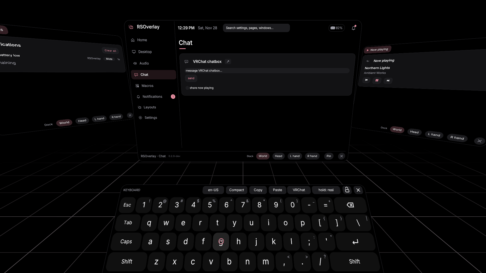

# RSOverlay

An open-source SteamVR overlay written in Rust, for gamers and for people
who work in VR. It behaves like **XSOverlay**: the same default bindings,
wrist toolbar, grab and scale, layouts and keyboard, so moving over is
easy. It has its own look, and it's built to be light.


| | |
|---|---|
|  |  |
|  |  |

<sub>Everything at a glance: [overview.png](docs/store/overview.png) ·
every setting: [settings-overview.png](docs/store/settings-overview.png).
Screenshots are rendered by the built-in VR preview (`--vr-preview --scene …`)
with mock window contents. See [docs/store](docs/store/README.md).</sub>

> **Not affiliated with XSOverlay or OVR Toolkit.** Every line is written
> from scratch against public Windows / OpenVR APIs. No code, assets or
> strings are copied. Feature parity comes from a feature-level study of
> how XSOverlay behaves ([XSO_PARITY.md](docs/XSO_PARITY.md)), and the
> notification API matches XSOverlay's public JSON shape so existing
> clients (VRCX etc.) keep working.

> **Status:** in active development; Steam release planned.

## Why

The popular overlays are built on Unity, Mono and Chromium, and pay for it
in RAM and CPU. RSOverlay is one native Rust binary: `wgpu` on DX12, GPU-to-GPU
capture (no frame ever goes through the CPU), and `egui` for the UI. Panels
you aren't looking at drop to ~5 fps, and hidden ones cost nothing. The
built-in **Stats** card measures RSOverlay's own CPU, RAM, VRAM and frame
time live, so you can check the claim yourself.

## Features

**Windows and desktops**
- Mirror any monitor (DXGI duplication, cursor included) or any single
  window (Windows Graphics Capture), several at once
- Laser mouse on the real window: left, right and middle click, drag,
  stick scroll
- UAC aware: elevated windows show a clear "use your PC" notice, with an
  optional run-as-administrator mode

**Panels in space**
- Grab to carry, stick to push/pull and resize, two-hand scale, with a live
  size/distance readout while you do it
- Every panel (windows, widgets, the dashboard) docks to world, head, left
  or right hand, and has a close button
- Recenter gathers everything in front of you; panels fade when viewed
  edge-on
- 8 layout slots, with one auto-loaded at startup

**Wrist toolbar**
- Compact by default (Dashboard, Keyboard, Add, Recenter, More), plus clock
  and media; More adds layout slots, views and device batteries
- Every button is labelled; tooltips name the rest

**Dashboard**
- Labelled sidebar; global search across settings, pages and windows
  (everyday actions live on the wrist, not duplicated here)
- Pop any card out as a floating widget; drop widgets onto each other to
  merge them into tabs, split them back out

**Keyboard**
- Physical layout with labels from your system keyboard layout
- Real key hold (no fake auto-repeat, which matters in games), sticky and
  lockable modifiers, VRChat chatbox mode, compact or full

**Everything else**
- Notifications: XSOverlay-compatible WebSocket API on `127.0.0.1:42069`,
  toasts + history
- Media: now playing + controls (SMTC); optional accent from album art
- Per-app volume mixer (WASAPI)
- Batteries for HMD, controllers and trackers, with playtime estimates,
  low-battery alerts and an optional VRChat avatar parameter (OSC)
- VRChat OSC chatbox, including "share now playing"
- Discord Rich Presence, macros, night light, 9 UI languages
- Accessibility: VR text size, reduce motion, laser visibility, cursor
  smoothing, scroll speed

**SteamVR integration**
- SteamVR Input with XSOverlay-style default bindings (Index, Touch, Vive,
  WMR), rebindable in SteamVR
- Registers itself as a SteamVR overlay app: starts with SteamVR (toggle in
  SteamVR › Startup) and exits with it

## Default controls

| Action | Input |
|---|---|
| Click / drag | Trigger |
| Right / middle click | Hold trackpad down / up while clicking (Index, Vive, WMR) |
| Grab a panel | Grip |
| Push / pull, resize (while grabbing) | Stick up/down, left/right |
| Show / hide dashboard | Double-press left A / X (or the wrist Dashboard button) |

## Run

```bash
cargo run -p rsoverlay-app -- --vr           # SteamVR (needs SteamVR running)
cargo run -p rsoverlay-app                   # desktop preview of the dashboard
cargo run -p rsoverlay-app -- --vr-preview   # the headset view, on your desktop
```

`--vr-preview` renders every panel in 3D through the same UI code as VR, so
design work doesn't need a headset. Keys **1–6** switch layout presets (work,
gaming, social, dashboard, wrist compact, wrist expanded); drag to look,
scroll to move, R resets the view.

After the first `--vr` run, SteamVR launches RSOverlay automatically.

### Common flags

```
--vr / --preview / --vr-preview   mode (default: --preview)
--list-monitors / --list-windows  print capture sources and exit
--monitor <idx>                   monitor to mirror in the preview (default 0)
--window <title>                  mirror a window instead of a monitor
--no-mirror / --no-gpu-mirror     disable capture / force the CPU path
--notify-bind <addr>              notification server (default 127.0.0.1:42069)
--no-notify / --no-osc / --no-discord
--osc-addr <addr>                 VRChat OSC input (default 127.0.0.1:9000)
--scene <preset>                  --vr-preview layout preset
--screenshot <png> --exit-after <frames>   headless render-to-PNG
```

### Test the notification server

```powershell
.\tools\send-toast.ps1 -Title "Build green" -Content "cargo clippy clean"
```

## Build

```bash
cargo build --workspace
cargo test --workspace
cargo clippy --workspace --all-targets
cargo deny check
```

Windows x64, Rust stable (edition 2021). Settings live in
`%APPDATA%\RSOverlay\` (`config.toml` hot-reloads; `layouts.toml`).

## Privacy and security

- Nothing leaves your PC: no telemetry (opt-in only, if ever)
- The notification API binds `127.0.0.1` only
- No clipboard history or capture: Copy / Paste only send the keystrokes
- `unsafe` only at FFI boundaries; OpenVR vtable slots are pinned by
  compile-time asserts against the official headers
- Future plugins: `wasmtime` sandbox only, never native DLLs

## Performance targets

| | Target |
|---|---|
| Cold start → first frame in VR | < 1 s |
| Idle RAM with one mirror | < 150 MB |
| Idle CPU | < 1 % |
| Mirror latency | < 16 ms |

Check them live on the dashboard's Stats card.

## Layout

```
crates/
├── rsoverlay-app/       binary: VR shell, desktop preview, VR preview
├── rsoverlay-ui/        egui UI: dashboard, wrist, keyboard, widgets, theme
├── rsoverlay-openvr/    hand-rolled OpenVR FFI (overlay, input, system, apps)
├── rsoverlay-render/    wgpu context and render targets
├── rsoverlay-capture/   DXGI desktop + Windows Graphics Capture
├── rsoverlay-input/     SendInput, keyboard scan codes, elevation checks
├── rsoverlay-notify/    XSOverlay-compatible notification WebSocket
├── rsoverlay-osc/       VRChat OSC
├── rsoverlay-discord/   Discord Rich Presence
├── rsoverlay-audio/     per-app volume (WASAPI)
├── rsoverlay-sysinfo/   CPU / GPU / RAM / VRAM sampling
└── rsoverlay-core/      config, layouts, shared types
docs/
├── ROADMAP.md  XSO_PARITY.md  ARCHITECTURE.md  NOTIFICATION_API.md  OSC.md
└── store/      1920×1080 store screenshots
```

## License

Dual-licensed under either of [MIT](LICENSE-MIT) or
[Apache-2.0](LICENSE-APACHE), at your option. Bundled fonts (Inter) are
under the SIL Open Font License, see `crates/rsoverlay-ui/src/fonts/`.
