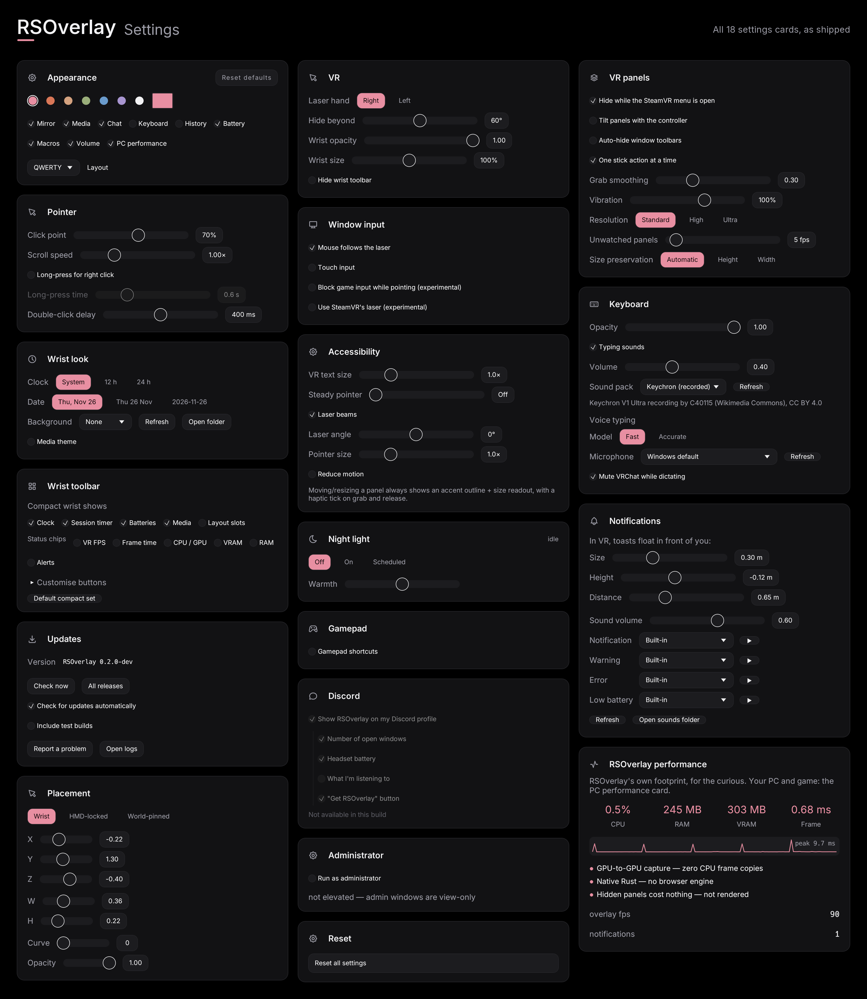
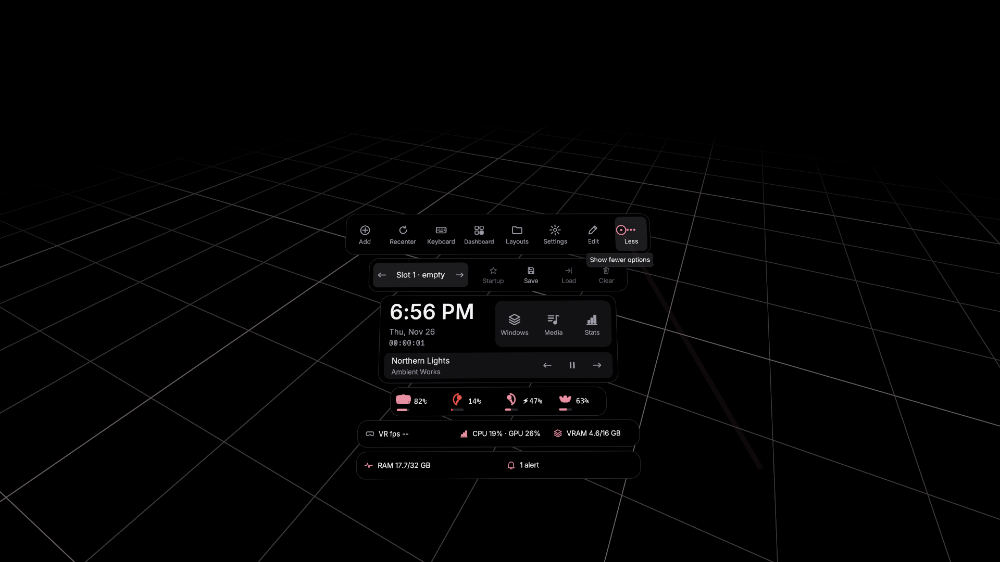

Third test build: a tidier Settings page, a calmer wrist, and your version is now easy to find for bug reports.

## Install / update

1. Download **RSOverlay-v0.2.0-beta.1-windows-x64.zip** below and unzip it. Updating? Replace your old `rsoverlay.exe`. Settings and layouts are kept.
2. Double-click `rsoverlay.exe`. It starts in VR when SteamVR and your headset are available, otherwise the desktop settings window opens.

**On beta.2?** Its update check had a bug that hid newer `0.1.0` test builds, which is why this one is numbered `0.2.0`. With **Include test builds** on, beta.2 will tell you about it.

## New

**Easy to see which version you're on**
- Settings › Updates shows the exact version and build (you can select and copy it), and it's in the corner of the VR dashboard, so it shows up in screenshots and videos
- **Report a problem** opens a new bug report with your version already filled in

**Tidier Settings**
- **Window input** has its own card: mouse follows the laser, touch input, block game input
- **Wrist look** has its own card: clock, date, background image, media theme
- Grab smoothing and vibration moved to **VR panels**, next to the other grab options
- Wrist toolbar: the button lists fold away under **Customise buttons**
- Gamepad is one line until you turn it on
- Placement, Administrator and Reset moved into **Advanced** at the bottom (search still finds them)

**Calmer wrist**
- The expanded wrist (More) shows 8 buttons instead of 10: **Close all** and **Focus** are now opt-in (Settings › Wrist toolbar › Customise buttons). If you never changed your buttons, this applies automatically; if you did, your choice is kept.

## Fixed

- Test builds are told about newer test builds (the update check compared against the wrong version).

## Feedback

Settings › Updates › **Report a problem**, or https://github.com/affectioned/RSOverlay/issues. A short video and your `rsoverlay.log` (Settings › Updates › Open logs) help a lot.

Verify the download: compare `RSOverlay-v0.2.0-beta.1-windows-x64.zip.sha256` with `certutil -hashfile RSOverlay-v0.2.0-beta.1-windows-x64.zip SHA256`.
