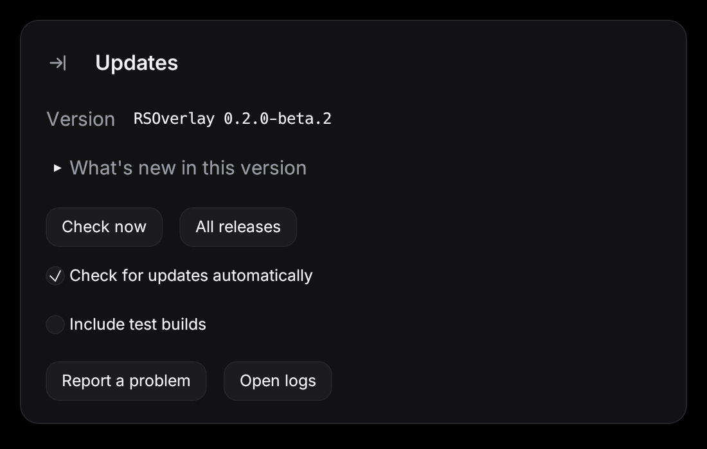
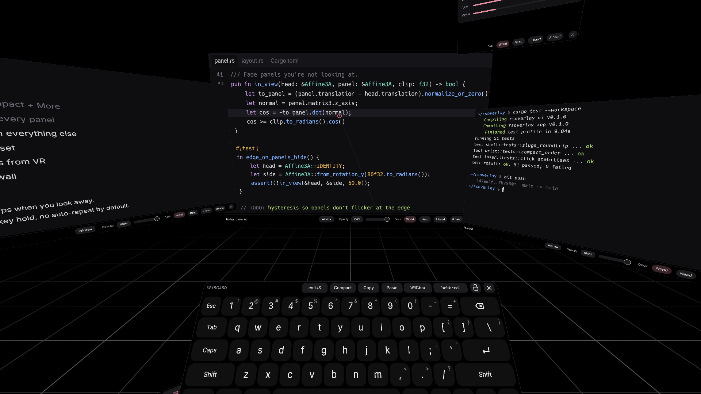

Fourth test build: RSOverlay can now update itself (when you say so), shows what's new, and gets a few quality-of-life additions for windows.

## Install / update

1. Download **RSOverlay-v0.2.0-beta.2-windows-x64.zip** below and unzip it. Updating? Replace your old `rsoverlay.exe`. Settings and layouts are kept.
2. Double-click `rsoverlay.exe`. It starts in VR when SteamVR and your headset are available, otherwise the desktop settings window opens.

This is the last time you'll need to download by hand: from this build on, updates install from inside RSOverlay.

## New

**Updates from inside RSOverlay**
- Settings › Updates shows **What's new** for an available update. **Install update** downloads it with a progress bar, checks it against the release's checksum and swaps it in; you restart when it suits you. Nothing updates without your click, and if anything goes wrong nothing is changed.
- After updating, RSOverlay tells you once and shows what's new in that version.

**Windows**
- The window toolbar's **Size** button is now a **Window** menu with **Keep smooth when not looking**: full frame rate for a video or a game you're watching out of the corner of your eye. The size presets are in the same menu.
- **Auto-hide window toolbars** (Settings › VR panels, off by default): a window's toolbar only appears while your laser is on it.
- Desktop page: hover a window and press **Hide** to keep every window of that program out of the list. **Show hidden** brings them back.

**Focus mode**
- Dimmed windows refresh less often, so your game gets the GPU back.
- Focus turns itself off when you close your last window.

## Changed

- The language picker is hidden for now: the interface is English only until it's properly translated.

## Feedback

Settings › Updates › **Report a problem**, or https://github.com/affectioned/RSOverlay/issues. A short video and your `rsoverlay.log` (Settings › Updates › Open logs) help a lot.

Verify the download: compare `RSOverlay-v0.2.0-beta.2-windows-x64.zip.sha256` with `certutil -hashfile RSOverlay-v0.2.0-beta.2-windows-x64.zip SHA256`.
