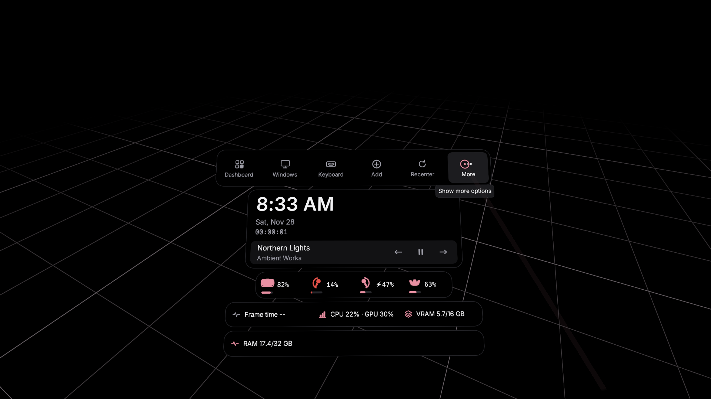
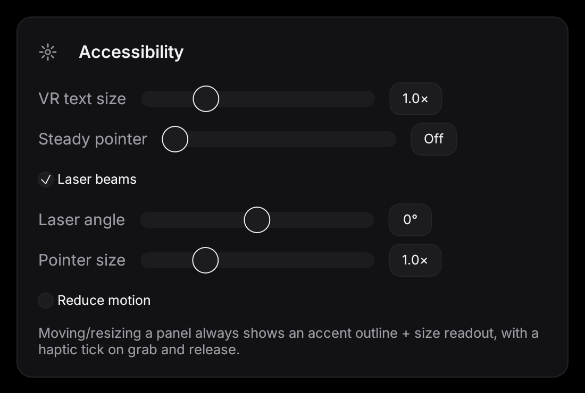

Fifth test build: sharper desktop windows, a Windows button on the wrist, frame times, and a steadier laser for shaky hands.

## Install / update

- **Already on beta.2?** Settings › Updates › **Install update**, then restart RSOverlay when it suits you.
- **New install:** download **RSOverlay-v0.2.0-beta.3-windows-x64.zip** below, unzip it and double-click `rsoverlay.exe`. It starts in VR when SteamVR and your headset are available, otherwise the desktop settings window opens.

## New

**Windows button**
- The wrist has a **Windows** button next to Dashboard: it shows or hides your desktop windows without opening the dashboard. Minimise Discord, bring it back with one press.
- Dashboard and Windows no longer affect each other: closing the dashboard never hides your windows. Opening a new window always brings your windows back.
- The Dashboard button lights up while the dashboard is open.

**Sharper desktop and window captures**
- Monitors and windows are now shown at their own resolution: a 2560-pixel-wide monitor gets a 2560-pixel-wide panel instead of being squeezed into 1920 first. Small text is much easier to read.
- **Window ▾ › Readable size** on a window's toolbar makes the panel big enough to read its text from where you are (up to 90° of your view).

**Frame time**
- CPU and GPU frame time (ms) from SteamVR, on the System card and as a new **Frame time** chip on the wrist (More › Edit to add it to the compact wrist). Red when over your headset's frame budget.

**Steady pointer (Accessibility)**
- Settings › Accessibility › **Steady pointer** smooths out shaky hands: it steadies the laser while you hold still and stays quick when you move on purpose. Off by default for new installs.

## Changed

- The laser aims where SteamVR draws your controller (predicted to when the frame reaches your eyes), and the cursor is drawn inside each panel, so the highlighted button or key is always the one you click.
- RSOverlay now updates once per headset frame, in step with SteamVR (it was about 60 times a second).
- Resting the laser on a window no longer grabs your PC mouse: it only moves the mouse when the laser really moves, and leaves it alone for 2 seconds after you touch the mouse.
- The "Windows hide with the dashboard" setting is gone (see the Windows button above). **Pin** on a window now keeps it up when the Windows button hides the rest.
- Builds you compile yourself report a `-dev` version and never check for updates.

## Known issues

- **The laser beam and cursor aren't yet 1:1 with SteamVR's own laser.** The cursor and what you click always agree, but the cursor can sit slightly behind the beam's tip, especially while you move. I'm working on it. There's an experimental **Use SteamVR's laser** option (Settings › Window input), but it misses clicks on some setups, so it's off by default.

## Feedback

Settings › Updates › **Report a problem**, or https://github.com/affectioned/RSOverlay/issues. A short video and your `rsoverlay.log` (Settings › Updates › Open logs) help a lot.

Verify the download: compare `RSOverlay-v0.2.0-beta.3-windows-x64.zip.sha256` with `certutil -hashfile RSOverlay-v0.2.0-beta.3-windows-x64.zip SHA256`.
