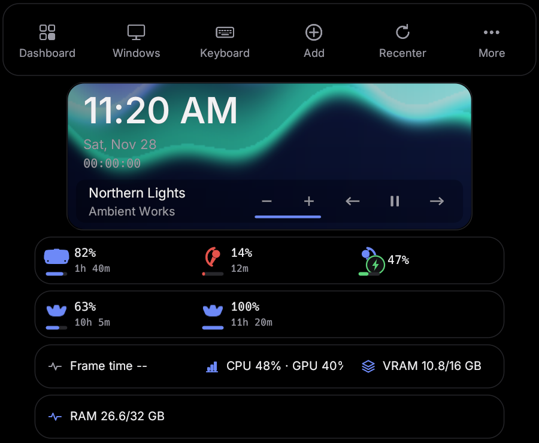

Sixth test build: the laser now hits exactly where it points, album covers and music volume on the wrist, and a lot of Index controller fixes.

## Install / update

- **Already on beta.2 or beta.3?** Settings › Updates › **Install update**, then restart RSOverlay when it suits you.
- **New install:** download **RSOverlay-v0.2.0-beta.4-windows-x64.zip** below, unzip it and double-click `rsoverlay.exe`. It starts in VR when SteamVR and your headset are available, otherwise the desktop settings window opens.

## New

**A laser that lands where it points**
- Keys and buttons above or below the middle of a panel were hit a row off (pointing at Esc lit a key two rows down). SteamVR measured our panels as if they were square; RSOverlay now corrects for it, so what lights up is exactly under the cursor ring, everywhere on every panel.
- The laser passes through the empty parts of panels, including the gaps between keys and the space above or below them. With the keyboard just under a monitor you can click the taskbar again.
- The beam and its cursor ring are one piece: the beam ends at the ring's edge and the ring sits on the exact point you're hitting, in your accent colour.
- The laser follows your controller every frame, so it no longer trails behind fast movements.
- Soft pulses of light run along the beam. Settings › Accessibility › **Reduce motion** keeps it still.

**Music on the wrist**
- **Album covers:** with **Media theme** on (Settings › Wrist toolbar), the cover of what's playing fills the clock and music panel. The accent colour now takes the cover's most vivid colour instead of a washed-out one.
- **Volume:** − / + buttons on the music row (or point at it and use the stick) change the volume of the app that's playing, with a level bar under them. Works with apps on any output device, e.g. Apple Music through Voicemeeter.

**Keyboard**
- Holding **⌫** deletes like an iPhone: letters first, then whole words, getting faster. Works on the desktop, in VRChat chatbox mode and in RSOverlay's own text fields.
- The default typing sound is now **Thock**, a deep mechanical keyboard sound. The old sound is still in Settings › Keyboard.

## Changed

**Index controllers**
- Clicks happen partway through the trigger pull instead of needing a full squeeze: Settings › Pointer › **Click point** (70% by default).
- Grabbing a window or the keyboard needs a deliberate squeeze, so sweaty hands or curled fingers don't grab by accident.
- Right / middle click modifiers need a trackpad press, not just a touch.

**Wrist**
- Charging devices show a green bolt at any battery level. Some controllers only report charging once they're full; RSOverlay now also notices a battery that's going up.
- Battery rows show at most three devices, with the time-left estimate on its own line, so nothing gets cut off.
- The **Windows** button also hides and restores the keyboard, so one press clears everything.

**Windows**
- Opening a minimised window (e.g. Discord) no longer gives a blank panel: it's restored behind your other windows, without taking focus.

## Known issues

- Your other hand's laser can still highlight keys while it rests on the keyboard. Only the hand that clicks types.

## Feedback

Settings › Updates › **Report a problem**, or https://github.com/affectioned/RSOverlay/issues. A short video and your `rsoverlay.log` (Settings › Updates › Open logs) help a lot.

Verify the download: compare `RSOverlay-v0.2.0-beta.4-windows-x64.zip.sha256` with `certutil -hashfile RSOverlay-v0.2.0-beta.4-windows-x64.zip SHA256`.
