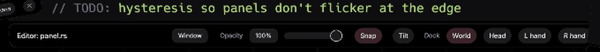

Seventh test build: a real Keychron keyboard sound, easier window docking you can see coming, and more control over each window.

## Install / update

- **Already on beta.2 or later?** Settings › Updates › **Install update**, then restart RSOverlay when it suits you.
- **New install:** download **RSOverlay-v0.2.0-beta.5-windows-x64.zip** below, unzip it and double-click `rsoverlay.exe`. It starts in VR when SteamVR and your headset are available, otherwise the desktop settings window opens.

## New

**A real keyboard sound**
- The VR keyboard now sounds like a real **Keychron V1 Ultra** (red linear switches): actual recorded keystrokes, with several takes per key played in a random order so fast typing doesn't sound like one sample on repeat. Space has its own deeper sound, and Enter, Backspace and the modifier keys each have their own.
- The synthesised **Thock** and **Classic clicks** are still in Settings › Keyboard › Sound pack.
- Your own sound packs can now have several takes per key too: add `key2.wav`, `key3.wav` … (up to 8). See [Custom sounds](https://github.com/affectioned/RSOverlay/blob/v0.2.0-beta.5/docs/SOUNDS.md).
- The recording is "Typing on Keychron V1 Ultra (Red Linear Switch)" by C40115 on [Wikimedia Commons](https://commons.wikimedia.org/wiki/File:Typing_on_Keychron_V1_Ultra_(Red_Linear_Switch).wav), CC BY 4.0, cut into single keystrokes.

**Window docking you can see**
- While you carry a window close enough to another one's edge, an outline in your accent colour shows exactly where it will snap, with a small buzz as it comes into range. Let go to dock.
- The outline flashes when a window docks, and when you **Unlink** it.
- Docking is much easier: windows that each face you side by side now join. Before, they were usually too angled to dock.

**More on the window toolbar**

- **Snap:** turn it off on a window that should never join others. It also leaves any group it's in. Remembered per window and in saved layouts.
- **Tilt:** turn it on to rotate windows with your controller while you hold them (twist or tilt your wrist); off, a held window always turns to face you. It's one setting for all windows, the same as Settings › VR panels › Tilt panels with the controller. Off by default.

**Dashboard Pin**
- The dashboard's bar has a **Pin** button: pinned, the dashboard reopens where you left it instead of in front of you, even after a restart.

## Feedback

Settings › Updates › **Report a problem**, or https://github.com/affectioned/RSOverlay/issues. A short video and your `rsoverlay.log` (Settings › Updates › Open logs) help a lot.

Verify the download: compare `RSOverlay-v0.2.0-beta.5-windows-x64.zip.sha256` with `certutil -hashfile RSOverlay-v0.2.0-beta.5-windows-x64.zip SHA256`.
