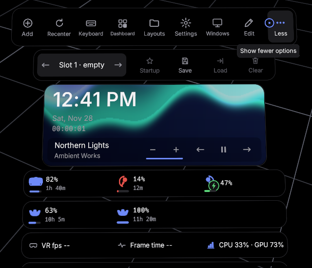

Eighth test build: a tidier wrist, monitors called by their real names, and a keyboard that only listens to the hand you're typing with.

## Install / update

- **Already on beta.2 or later?** Settings › Updates › **Install update**, then restart RSOverlay when it suits you.
- **New install:** download **RSOverlay-v0.2.0-beta.6-windows-x64.zip** below, unzip it and double-click `rsoverlay.exe`. It starts in VR when SteamVR and your headset are available, otherwise the desktop settings window opens.

## Changed

**Monitors have their real names**
- Monitor windows, the window list and the dashboard's source picker show your monitor's own name, the one Windows' Display Settings shows (e.g. "Q27G4"), instead of "Monitor 0". Two monitors of the same model show as "(1)" and "(2)"; one without a name stays "Monitor N".

**Keyboard: a resting hand stays dark**
- Only the hand you're typing with lights up keys. Your other hand's laser can rest on the keyboard without highlighting anything.
- Typing with both hands still lights up both, and pressing with the resting hand makes it active again straight away.

**A tidier wrist**
- The Windows / Media / Stats box is gone: it doubled the wrist's Windows button, the music controls and the Stats pop-out. The clock and music panel now use the full width.

## Feedback

Settings › Updates › **Report a problem**, or https://github.com/affectioned/RSOverlay/issues. A short video and your `rsoverlay.log` (Settings › Updates › Open logs) help a lot.

Verify the download: compare `RSOverlay-v0.2.0-beta.6-windows-x64.zip.sha256` with `certutil -hashfile RSOverlay-v0.2.0-beta.6-windows-x64.zip SHA256`.
